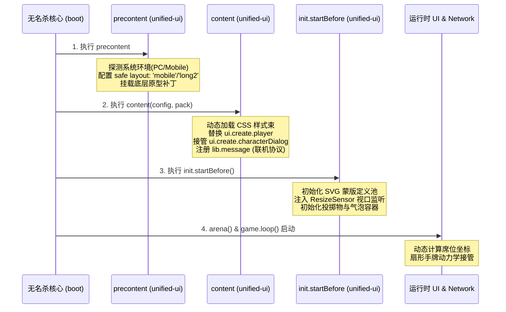
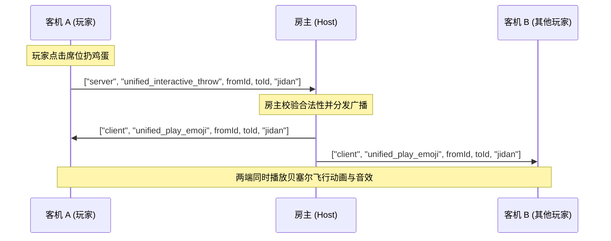

# 《无名杀》一体化 UI 插件重构设计规范与资产清单
（融合十周年视觉 + 手杀互动体系 + 选将美化 + PC适配 + 客户端联机支持）

---

## 0. 项目定位与工程绝对路径映射

本方案指导在项目 `C:\Users\SB-Yo\Project\game\noname` 中完成一体化 UI 插件的后续开发。

将原本分散在测试运行时目录 `C:\Users\SB-Yo\Application\Noname\resources\app\extension` 下的 4 个核心插件（`十周年UI`、`手杀ui`、`电脑适配`、`选将美化`），完整收敛并复刻至目标仓库的扩展目录：
`C:\Users\SB-Yo\Project\game\noname\apps\core\extension\unified-ui`。

### 0.1 核心绝对目录速查

| 模块 / 角色 | 绝对路径 | 作用说明 |
| :--- | :--- | :--- |
| **开发工程根目录** | `C:\Users\SB-Yo\Project\game\noname` | 源码仓库根目录，基于 pnpm monorepo 构建 |
| **新插件工作目录** | `C:\Users\SB-Yo\Project\game\noname\apps\core\extension\unified-ui` | 一体化 UI 插件的目标开发路径 |
| **无名杀内核代码** | `C:\Users\SB-Yo\Project\game\noname\apps\core\noname` | 包含 `init/`、`ui/`、`library/`、`game/` 等核心运行时 |
| **权威设计与机制文档**| `C:\Users\SB-Yo\Project\game\noname\docs\YRD` | 包含 UI 指南（15篇）、联机指南（16篇）等 22 篇源码级文档 |
| **开发辅助技能包** | `C:\Users\SB-Yo\Project\game\noname\.agents\skills\noname-general-extension` | 增量知识库与 6700+ 技能检索引擎 |
| **原始资源源路径** | `C:\Users\SB-Yo\Application\Noname\resources\app\extension` | 运行端中的原始已装扩展（资产提取来源） |

---

## 1. 目标插件目录拓扑结构

插件位于：`C:\Users\SB-Yo\Project\game\noname\apps\core\extension\unified-ui`

```text
C:\Users\SB-Yo\Project\game\noname\apps\core\extension\unified-ui\
├── extension.js                    # 插件主入口（生命周期装配、环境探测、配置项）
├── style\
│   ├── base.css                   # 基础容器、层级治理、字体与通配复位
│   ├── player.css                 # 席位骨架、主副将SVG裁切、装备栏、标记与链锁
│   ├── handcards.css              # 扇形曲面手牌排布、出牌悬浮与动力学发牌补帧
│   ├── interactive.css            # 互动表情投掷物、聊天气泡、shoushaBlanks 高斯模糊
│   └── chooseCharacter.css        # 选将画廊大看板、等阶角标与技能预览面板
├── js\
│   ├── environment.js             # 跨端适配层：视口探测、输入设备映射（鼠标转手势）
│   ├── playerRenderer.js          # 席位 DOM 生成引擎（替代 ui.create.player）
│   ├── handcardPhysics.js         # 手牌曲线排布数学模型与发牌帧动画调度
│   ├── interactiveSystem.js       # 投掷物贝塞尔抛物线动画机与音效触发
│   ├── characterGallery.js        # 选将画廊控制器（替代 chooseCharacter/Two）
│   └── networkClient.js           # 联机客机消息监听、数据序列化与主机广播契约
└── assets\                        # 物理迁移后的独立素材目录
    ├── image\
    │   ├── player\
    │   ├── equips\
    │   ├── interactive\
    │   └── gallery\
    ├── audio\
    └── font\
```

---

## 2. 插件生命周期与装配注入流程

无名杀的插件加载流程严格受控于 `C:\Users\SB-Yo\Project\game\noname\apps\core\noname\init\import.ts` 与 `C:\Users\SB-Yo\Project\game\noname\apps\core\noname\init\loading.ts`。



### 2.1 主入口代码结构 (`extension.js`)
文件位置：`C:\Users\SB-Yo\Project\game\noname\apps\core\extension\unified-ui\extension.js`

```javascript
game.import("extension", function(lib, game, ui, get, ai, _status) {
    return {
        name: "unified-ui",
        editable: false,
        precontent: function() {
            // 1. 跨端自适应（替代原“电脑适配”粗暴修改 lib.device = "android"）
            // 保持 lib.device 不被污染，仅在 PC 桌面端建立鼠标点击位移阈值监听器
            if (!lib.config.touchscreen && !('ontouchstart' in window)) {
                lib.config.unified_pc_mode = true;
            }
            // 2. 布局前置校验与自动纠偏（确保使用兼容十周年与手杀的基底布局）
            if (!['mobile', 'long2', 'nova'].includes(lib.config.layout)) {
                game.saveConfig('layout', 'mobile');
                game.layout = 'mobile';
            }
        },
        content: function(config, pack) {
            // 动态引入并装配各子模块
            const extUrl = lib.assetURL + "extension/unified-ui/";
            
            // 加载一体化样式表
            lib.init.css(extUrl + "style/base", "style");
            lib.init.css(extUrl + "style/player", "style");
            lib.init.css(extUrl + "style/handcards", "style");
            lib.init.css(extUrl + "style/interactive", "style");
            lib.init.css(extUrl + "style/chooseCharacter", "style");

            // 导入并装配业务逻辑子系统
            import(extUrl + "js/playerRenderer.js").then(m => m.initPlayerRenderer(lib, game, ui, get));
            import(extUrl + "js/handcardPhysics.js").then(m => m.initHandcardPhysics(lib, game, ui, get));
            import(extUrl + "js/interactiveSystem.js").then(m => m.initInteractiveSystem(lib, game, ui, get));
            import(extUrl + "js/characterGallery.js").then(m => m.initCharacterGallery(lib, game, ui, get));
            import(extUrl + "js/networkClient.js").then(m => m.initNetworkClient(lib, game, ui, get));
        },
        config: {
            enable_handcard_curve: { name: "扇形手牌曲率", init: true },
            enable_interactive_emoji: { name: "手杀互动表情", init: true },
            enable_gallery_choose: { name: "画廊美化选将", init: true },
            enable_blur_effect: { name: "遮罩高斯模糊", init: true }
        }
    };
});
```

---

## 3. UI 视觉重构与 DOM 交互规范

### 3.1 视口与单位规范（参照 `C:\Users\SB-Yo\Project\game\noname\docs\YRD\15-ui-development.md`）
*   **绝对禁止使用 `vh` / `vw`**：引擎在 `C:\Users\SB-Yo\Project\game\noname\apps\core\noname\ui\create\index.js` 的 `ui.refresh()` 会对 `#window` 施加缩放变换，`vh`/`vw` 换算极不稳定，极易导致容器高度塌陷为 0。所有动态高度均在 JS 中测量并以内联 `px` 赋值。
*   **`.content { font-size: 0px }` 盒模型防御**：原生 `C:\Users\SB-Yo\Project\game\noname\apps\core\layout\default\layout.css` 第 1901 行为了消除 inline-block 缝隙，定义了 `.content { font-size: 0px }`，且只对**直接子元素**恢复 16px。任何深层嵌套的 DOM 必须显式写明 `font-size: 14px`。
*   **通配布局复位**：从 `dialog.buttons` 迁移节点或构建自定义弹窗时，必须施加通配复位：
    ```css
    position: static !important;
    float: none !important;
    box-sizing: border-box !important;
    writing-mode: horizontal-tb !important;
    ```

---

### 3.2 武将席位 (`.player`) 1:1 复合 DOM

替换原生 `ui.create.player`，构造符合十周年切角立绘与手杀互动层挂载的标准骨架：

```text
div.player (.me / .selectable / .target / .dead)
 ├── svg.dui-clip-defs (仅全局定义一次，挂载在 document.body)
 ├── div.primary-avatar (主将立绘，clip-path: url(#solo-clip) 或 url(#duol-clip))
 ├── div.deputy-avatar (副将立绘，clip-path: url(#duor-clip))
 ├── div.avatar-frame (十周年外框装饰、等阶角标、动态光影)
 ├── div.turned-over (翻面暗化遮罩层)
 ├── div.chain (SVG 铁锁连环动态链条节点)
 ├── div.identity (身份/阵营角标)
 ├── div.hp.glass-hp (水晶拟态血条 + 护甲数值 badge)
 ├── div.name (主将文字称号与名牌)
 ├── div.name2 (副将文字名牌)
 ├── div.card-count (手牌数指示器)
 ├── div.equips (四格横向插槽：武器/防具/坐骑/宝物，含小图标)
 ├── div.judges (延时锦囊判定区插槽)
 ├── div.dui-marks (环形动态技能标记插槽)
 └── div.interactive-touch-layer (PC/触屏投掷表情感应层，监听点击/鼠标位移)
```

#### SVG ClipPath 路径定义（注入至 `document.body`）
```html
<svg width="0" height="0" style="position:absolute;display:none;">
  <defs>
    <!-- 单将切角蒙版 -->
    <clipPath id="solo-clip" clipPathUnits="objectBoundingBox">
      <path d="M0 0 H1 Q1 0.05 0.9 0.06 Q1 0.06 1 0.11 V1 H0 Z" />
    </clipPath>
    <!-- 双将主将左切蒙版 -->
    <clipPath id="duol-clip" clipPathUnits="objectBoundingBox">
      <path d="M0 0 H0.55 L0.45 1 H0 Z" />
    </clipPath>
    <!-- 双将副将右切蒙版 -->
    <clipPath id="duor-clip" clipPathUnits="objectBoundingBox">
      <path d="M0.55 0 H1 V1 H0.45 Z" />
    </clipPath>
  </defs>
</svg>
```

---

### 3.3 扇形曲面手牌排布数学模型 (`handcardPhysics.js`)

手杀与十周年风格的核心视觉在于本家（`game.me`）的手牌呈**圆弧辐射排布**，并在出牌与摸牌时带有平滑补帧：

1. **中线对齐角**：
   $$\theta_i = \left(i - \frac{N - 1}{2}\right) \times \Delta\theta$$
   其中每张最大夹角 $\Delta\theta = \min\left(5^\circ, \frac{40^\circ}{N}\right)$。
2. **垂直弧度补偿（弓形矢高）**：
   $$Y_i = - R \cdot (1 - \cos\theta_i) + \text{offsetY}$$
   其中等效曲率半径 $R \approx 800\text{px}$。
3. **水平紧凑度缩放**：
   $$X_i = \left(i - \frac{N - 1}{2}\right) \times \text{cardStep}$$
   其中 $\text{cardStep} = \min\left(90\text{px}, \frac{\text{arenaWidth} \times 0.6}{N}\right)$。
4. **CSS 变换矩阵**：
   ```javascript
   card.style.transform = `translateX(${X_i}px) translateY(${Y_i}px) rotate(${theta_i}deg)`;
   card.style.zIndex = i + 10;
   ```

---

### 3.4 手杀互动表情与高斯遮罩 (`interactiveSystem.js`)

#### 1. 投掷物贝塞尔抛物线动画
*   从发起角色席位中心点 $(x_1, y_1)$ 到目标席位中心点 $(x_2, y_2)$。
*   通过 CSS 关键帧或内联 transition 驱动三阶贝塞尔曲线：
    ```css
    .flying-emoji {
        transition: left 0.6s cubic-bezier(0.25, 1, 0.5, 1),
                    top 0.6s cubic-bezier(0.5, -0.5, 0.75, 1),
                    transform 0.6s ease-in;
    }
    ```
*   动画完成后在目标席位爆开碎裂粒子，并调用 `game.playAudio(...)` 播放命中音效。

#### 2. 全局高斯模糊遮罩 (`shoushaBlanks`)
当呼出选将画廊、互动菜篮子或结算弹窗时，对周围 `.player` 与 DOM 节点应用 `blur(3px)` 与 `opacity: 0.3`。

---

## 4. 客户端联机（Client Online Networking）架构与通信协议

基于 `C:\Users\SB-Yo\Project\game\noname\docs\YRD\16-online-development.md` 的核心认知：
1. **房主（Host）**：拥有完整 `GameEvent` 逻辑树，运行游戏规则，`lib.node.clients` 数组持有所有客机连接。
2. **客机（Client）**：**没有 `GameEvent` 树**（`getParent` 走 `_modparent`，`_triggered` 恒为 `null`），只负责渲染 UI 并向主机发送交互选择结果。
3. **消息格式**：所有 WebSocket 报文均为 JSON 数组 `[route, handlerName, ...args]`。

### 4.1 联机协议通信时序



### 4.2 联机协议接口注册 (`networkClient.js`)
文件位置：`C:\Users\SB-Yo\Project\game\noname\apps\core\extension\unified-ui\js\networkClient.js`

```javascript
export function initNetworkClient(lib, game, ui, get) {
    // =============================================================
    // 1. 客机接收表 (lib.message.client)
    // 无论是客机还是房主客户端，均会监听并驱动本地动效渲染
    // =============================================================

    // 接收联机互动表情播放广播
    lib.message.client.unified_play_emoji = function(fromId, toId, emojiType) {
        const fromPlayer = lib.playerOL[fromId] || game.findPlayer(p => p.playerid === fromId);
        const toPlayer = lib.playerOL[toId] || game.findPlayer(p => p.playerid === toId);
        if (fromPlayer && toPlayer && window.unifiedUI) {
            window.unifiedUI.playThrowAnimation(fromPlayer, toPlayer, emojiType);
        }
    };

    // 接收联机美化选将看板指令
    lib.message.client.unified_open_character_gallery = function(list, targetPlayerId, selectNumber) {
        if (game.me && game.me.playerid === targetPlayerId && window.unifiedUI) {
            window.unifiedUI.openCharacterGallery(list, selectNumber, function(selected) {
                // 客机选择完成后，回传给房主
                game.send("unified_submit_character", selected);
            });
        }
    };

    // =============================================================
    // 2. 主机处理表 (lib.message.server)
    // 仅房主有权执行（this 为 Client 实例），处理完毕后向房间广播
    // =============================================================
    if (typeof lib.message.server !== "undefined") {
        // 主机收到客机发来的投掷表情请求，广播给所有客机
        lib.message.server.unified_interactive_throw = function(fromId, toId, emojiType) {
            game.broadcastAll("unified_play_emoji", fromId, toId, emojiType);
        };

        // 主机收到客机提交的选将结果
        lib.message.server.unified_submit_character = function(selected) {
            const playerId = this.playerid;
            const player = game.findPlayer(p => p.playerid === playerId);
            if (player && player._characterGalleryResolve) {
                player._characterGalleryResolve(selected);
                delete player._characterGalleryResolve;
            }
        };
    }
}
```

---

## 5. 完整素材引用清单与物理迁移对照表

将以下资源从测试运行端复制到新插件的 `assets/` 目录：

### 5.1 图像资源迁移表

| 目标相对路径 (`assets/image/`) | 原始源绝对路径 (`C:\Users\SB-Yo\Application\Noname\resources\app\extension\...`) | 规格与格式 | 界面用途说明 |
| :--- | :--- | :--- | :--- |
| `player/solo_frame.png` | `十周年UI\image\decoration\border.png` | 180×240 PNG | 单将头像框外层装饰 |
| `player/duo_frame.png` | `十周年UI\image\decoration\borderx.png` | 240×240 PNG | 双将头像框组合框 |
| `player/glass_hp.png` | `十周年UI\assets\item\scdialog.png` | 9-Patch PNG | 玻璃质感圆角血条背景 |
| `player/hujia.png` | `十周年UI\image\ass\hujia.png` | 48×48 PNG | 护甲/护盾标记图标 |
| `player/chain.png` | `十周年UI\image\ass\chain.png` | 64×64 PNG | 铁锁横置动态链环 |
| `equips/*.png` (18类装备) | `十周年UI\image\ass\*.png` | 40×40 PNG | 装备栏内嵌专属图标（武器/防具/马匹/宝物） |
| `interactive/cailan.png` | `手杀ui\sayplay\cailan.png` | 72×72 PNG | 呼出投掷物界面的“菜篮子”图标 |
| `interactive/jidan.png` | `手杀ui\sayplay\jidan.png` | 64×64 PNG | 投掷物：鸡蛋（含飞行态与碎裂帧） |
| `interactive/meijiu.png` | `手杀ui\sayplay\meijiu.png` | 64×64 PNG | 投掷物：美酒（举杯光效） |
| `interactive/xianhua.png` | `手杀ui\sayplay\xianhua.png` | 64×64 PNG | 投掷物：鲜花（花瓣飘落粒子） |
| `interactive/tuoxie.png` | `手杀ui\sayplay\tuoxie.png` | 64×64 PNG | 投掷物：拖鞋（旋转打击） |
| `interactive/xueqiu.png` | `手杀ui\sayplay\xueqiu.png` | 64×64 PNG | 投掷物：雪球（爆裂冰渣） |
| `interactive/saydiv.png` | `手杀ui\sayplay\saydiv.png` | 9-Patch PNG | 角色头顶聊天喊话对话框底图 |
| `gallery/xuanjiang_bg.png`| `选将美化\assets\image\xuanjiang.png` | 1920×1080 PNG | 选将画廊大看板全屏背景装饰 |
| `gallery/tier_sss.png` | `选将美化\assets\image\PJ_skill_zhuangbeixuanzhong.png` | PNG 透明 | 武将稀有度/强度等阶徽标 |
| `gallery/seat.png` | `选将美化\assets\image\seat.png` | 64×64 PNG | 选将时自己座位标识图 |

---

### 5.2 音效资源迁移表

| 目标相对路径 (`assets/audio/`) | 原始源绝对路径 (`C:\Users\SB-Yo\Application\Noname\resources\app\extension\...`) | 规格与格式 | 触发时机与逻辑绑定 |
| :--- | :--- | :--- | :--- |
| `game_start.mp3` | `十周年UI\audio\game_start.mp3` | MP3, ~37KB | 战局开始 `gameStart` 事件广播触发 |
| `kill_effect.mp3`| `十周年UI\audio\kill_effect_sound.mp3` | MP3, ~60KB | 击杀任意角色 `dieAfter` 触发战局播报 |
| `huan.mp3` | `手杀ui\sayplay\audio\huan.mp3` | MP3, ~16KB | 呼出互动表情菜单点击音效 |
| `hit_jidan.mp3` | `手杀ui\sayplay\audio\jidan.mp3` | MP3, ~25KB | 鸡蛋碎裂声 |
| `hit_tuoxie.mp3`| `手杀ui\sayplay\audio\tuoxie.mp3` | MP3, ~22KB | 拖鞋重击拍打声 |
| `hit_meijiu.mp3`| `手杀ui\sayplay\audio\meijiu.mp3` | MP3, ~30KB | 敬酒碰杯清脆声 |

---

### 5.3 字体引用对照表

| 字体名称 | 建议存放路径 | 配置键值 | 适用元素 | 回退降级方案 |
| :--- | :--- | :--- | :--- | :--- |
| **方正黄草 (HuangCao)** | `assets/font/huangcao.ttf` | `lib.config.name_font` | 武将名牌 `.name`、副将名 `.name2` | `xinwei`, `xinkai`, serif |
| **手杀正字 (ShouSha)** | `assets/font/shousha.ttf` | `lib.config.global_font`| 系统弹窗、技能名、按钮文案 | `source-han-sans`, sans-serif |
| **华文隶书 (LiShu)** | `assets/font/lishu.ttf` | `lib.config.cardtext_font`| 扇形手牌描述文字、装备牌名 | `kaiti`, serif |

---

## 6. 后续工程落地与验证流程

在 `C:\Users\SB-Yo\Project\game\noname` 目录下执行后续工作：

1. **资源迁移**：
   通过 PowerShell 脚本将第 5 节清单中的文件从 `C:\Users\SB-Yo\Application\Noname\resources\app\extension` 复制到 `C:\Users\SB-Yo\Project\game\noname\apps\core\extension\unified-ui\assets`。
2. **源码实现**：
   按第 1 节和第 2 节的代码架构，在 `unified-ui` 目录下编写各模块 JS 与 CSS 代码。
3. **扩展注册与启用**：
   使用项目自带的技能工具链：
   ```powershell
   cd C:\Users\SB-Yo\Project\game\noname\.agents\skills\noname-general-extension\scripts
   node register-extension.mjs guideall --enable
   ```
4. **单机与联机双模验证**：
   - **单机验证**：启动开发环境（`pnpm dev`），核对席位切角、扇形手牌曲线与扔鸡蛋抛物线是否正常。
   - **客机联机验证**：启动本地服务器（`pnpm dev:server`），启动两个客户端分别以 Host 和 Client 接入房间，验证投掷物广播同步与联机选将看板。
